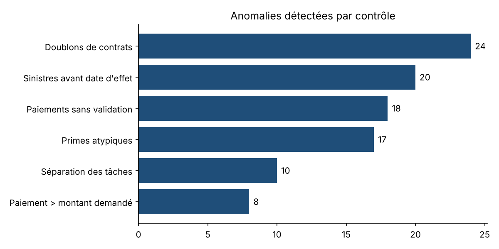
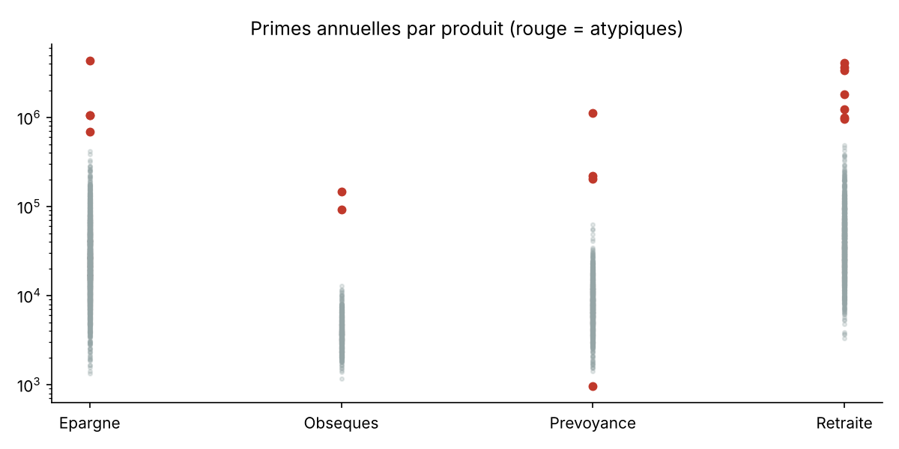
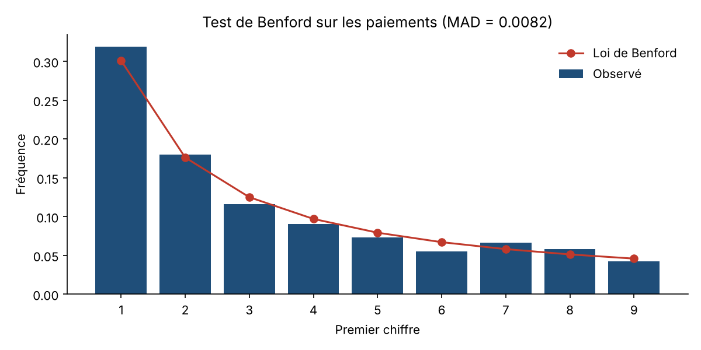

# 🔎 Audit Data Analytics – tests d'audit automatisés en Python

**Contrôler 100 % des opérations au lieu d'un échantillon.** Ce projet programme en Python (pandas) les tests qu'une direction de l'Audit applique aux données d'un assureur vie : doublons, montants atypiques, incohérences de dates, contrôle « 4 yeux », séparation des tâches et loi de Benford. Il produit ensuite un rapport HTML et un fichier Excel des anomalies.

> Les données sont **100 % fictives**, générées par `src/generate_data.py`. Des anomalies y sont injectées volontairement, et les tests unitaires vérifient que chaque contrôle les retrouve toutes.



## Résultats sur le jeu fictif

5 012 contrats · 1 800 sinistres · 1 500 paiements

| Contrôle | Règle | Anomalies |
|---|---|---|
| Doublons de contrats | même client, produit, date d'effet et prime | 24 lignes (12 paires) |
| Primes atypiques | z-score robuste (médiane/MAD) sur le log de la prime, par produit | 17 |
| Sinistres avant date d'effet | date de déclaration < date d'effet du contrat | 20 |
| Paiements sans validation | aucun valideur | 18 |
| Séparation des tâches | créateur = valideur | 10 |
| Paiement > montant demandé | montant payé supérieur à la demande | 8 |
| Loi de Benford | 1er chiffre des paiements, seuils de Nigrini | MAD = 0,0082 (conformité acceptable) |

**1,33 M€** ont été payés sans contrôle « 4 yeux » réel. Les 15 primes gonflées injectées sont toutes détectées, plus 2 valeurs naturellement extrêmes qu'un auditeur vérifierait.

<p float="left">


</p>

## Pourquoi ces choix

- **Z-score robuste plutôt que moyenne/écart-type** : les montants d'assurance sont très asymétriques et les valeurs extrêmes faussent la moyenne. La médiane et la MAD n'ont pas ce défaut.
- **Une colonne `motif` par anomalie** : chaque ligne remontée dit pourquoi, pour que l'auditeur puisse la traiter directement.
- **Des tests unitaires qui comptent les anomalies injectées** : on prouve que chaque contrôle a un rappel de 100 % sur les cas connus.

## Lancer le projet

```bash
pip install -r requirements.txt
python src/run_audit.py      # génère les données, lance les contrôles, écrit results/
python -m pytest -q          # 5 tests
```

Sorties : `results/rapport_audit.html`, `results/anomalies.xlsx` (un onglet par contrôle), `results/anomalies.csv`, `results/synthese.csv`.

## Structure

```
src/generate_data.py   données fictives + anomalies injectées
src/audit_tests.py     bibliothèque de contrôles réutilisables
src/run_audit.py       campagne d'audit, graphiques, rapport HTML/Excel
tests/                 vérification du rappel de chaque contrôle
```

**Pistes** : ajouter un modèle non supervisé (Isolation Forest) pour les anomalies sans règle connue, et brancher le tout sur une base SQL.

---
Pascale KAMDEM · Data & IA · [LinkedIn](https://www.linkedin.com/in/merveille-kamdem-562aa0284/)
